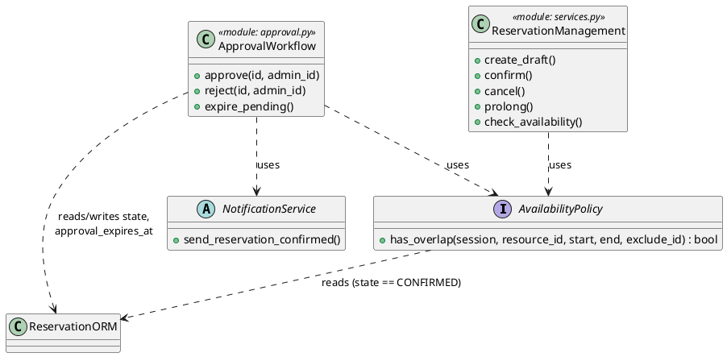
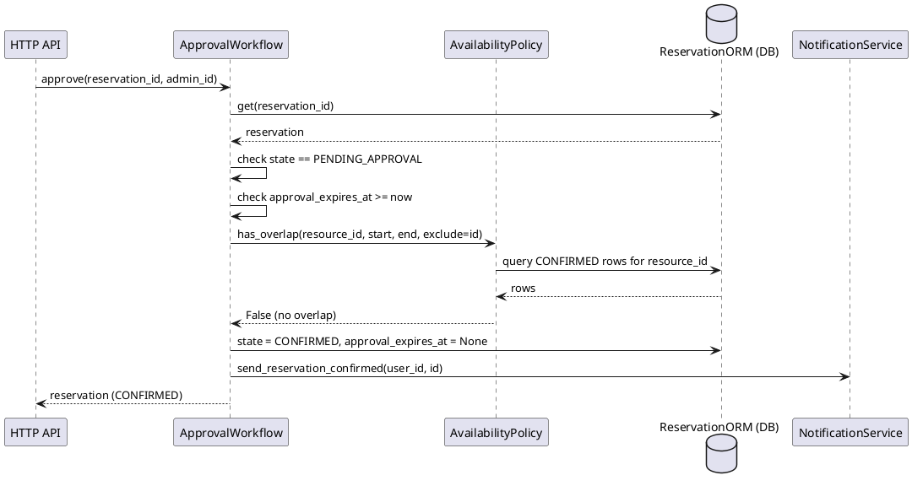

# Architecture and Decisions

## Stack
- **Language:** Python 3.12
- **Web framework:** FastAPI — chosen for low-boilerplate request validation
  (via Pydantic) and automatic OpenAPI docs, which makes the CP1 walking
  skeleton easy to poke at and demo without extra tooling.
- **Persistence:** SQLAlchemy ORM over SQLite (a real, on-disk database file,
  `parking.db`) — chosen over Postgres for this stage because it needs no
  separate server process, keeping the reproducible-build bar low (`pip
  install` + run), while still being a genuine relational DB with real
  durability, which is what the persistence spike needed to prove.
- **Testing:** pytest, with an in-memory SQLite DB (`sqlite:///:memory:`) for
  fast unit tests, and a dedicated on-disk DB file for the persistence spike
  test specifically (see `tests/test_persistence_spike.py`), so that test
  is actually exercising real file persistence rather than the same
  in-process state.

## Layering
- `src/models.py` — plain dataclasses for the domain concepts (Resource,
  User, Reservation, ReservationState). These are intentionally
  framework-agnostic.
- `src/db.py` — SQLAlchemy ORM models and engine/session setup.
- `src/availability.py` **(added in C05)** — the Availability Policy: the
  single `has_overlap()` contract that decides whether a resource slot is
  free. Extracted out of `services.py` so that `services.py` and
  `approval.py` depend on one declared interface instead of one module
  reaching into another's private helper. See the C05 section below.
- `src/services.py` — business rules and lifecycle for Create / Confirm /
  Cancel / Prolong / Check Availability: operating-hours validation,
  duration/future-start rules, and the DRAFT -> CONFIRMED /
  PENDING_APPROVAL -> CANCELLED transitions it owns. As of C03 it
  deliberately does **not** own what happens to a PENDING_APPROVAL
  reservation next — see ADR-01 below. As of C05 it delegates the overlap
  decision itself to `availability.py`.
- `src/approval.py` **(added in C03)** — the Approval Workflow: `approve`,
  `reject`, `expire_pending`. Owns the three outcome transitions out of
  PENDING_APPROVAL exclusively. See ADR-01 and the C05 Detailed Design
  below (this is the unit C05 was done on).
- `src/accounts.py` / `src/auth.py` — registration, login, session tokens,
  PBKDF2 password hashing.
- `src/notification.py` — the Notification Service boundary, defined as an
  abstract interface (`NotificationService`) with a stub implementation
  (`StubNotificationService`) that can simulate success, timeout, or
  failure. This keeps the boundary explicit and swappable.
- `src/main.py` — the FastAPI HTTP layer. Thin: it only translates
  HTTP <-> service calls and turns `ReservationError` into HTTP 400s (and
  `NotAuthorizedError` into 403s). Also serves `static/index.html` at `/ui`.

## Key decision: fixed seeded resources instead of a resource-management API
A parking-spot inventory is created once at startup (`db.seed_resources`)
rather than through a create/delete API. C01's scope doesn't require the
maintenance role to add/retire spots yet, so a fixed seed list was simpler
than building resource CRUD we don't yet need.

## Key decision: plate number as the user identifier
The UI collects a name and a license plate. Rather than introducing a
separate `User` table for C01, the plate number is stored as `user_id`
(it's a natural unique identifier for "who's parking") and the name is
stored alongside it purely for display (`user_name`, optional).

## Key decision: cancel, not delete
"Cancel a reservation" calls the existing `cancel` operation rather than
deleting the row. This preserves history and keeps a single state machine
as the only way a reservation's status changes.

## Key decision: stdlib-only password hashing
Accounts hash passwords with PBKDF2-HMAC-SHA256 via Python's built-in
`hashlib`, rather than `bcrypt`/`passlib`/`argon2`, which ship as compiled
native packages and caused real build failures on Windows + Python 3.14 for
this team. PBKDF2 with a random per-account salt is a reasonable, standard
choice at this scope.

## Key decision: session tokens stored in the database, not in memory
Login sessions live in a `sessions` table (token -> account_id), not an
in-process dict, so a login survives an `--reload` restart.

## Key decision: 30-minute increments and a 4-hour cap
`RESERVATION_STEP_MINUTES = 30` and `MAX_DURATION_MINUTES = 240` in
`services.py` are simple constants, not configuration.

## Key decision: ORM objects as the working representation
We operate directly on `ReservationORM` objects in `services.py`/`approval.py`
rather than mapping every DB row to-and-from the plain `Reservation`
dataclass in `models.py`. This trades some architectural purity for less
code. If the Q/Scale future pressure (see `intent-and-change.md`) is acted
on, revisiting this boundary — alongside stricter transaction isolation
for the overlap check — is one of the first things we'd reconsider.

## Key decision: operating hours as a service-layer constant
`OPERATING_HOURS_START` / `OPERATING_HOURS_END` live in `services.py` as
constants rather than configuration, since the project doesn't require
per-resource or per-lot operating hours yet.

## ADR-01 — Where should the Approval Workflow be owned? (C03)
**Decision:** Alternative A — the Approval Workflow stays inside the same
deployable as the rest of the system, but as its own module
(`src/approval.py`) with exclusive, mechanically-checked ownership of the
`PENDING_APPROVAL -> {CONFIRMED, REJECTED, EXPIRED}` transitions (checked
by `tests/test_architecture_rule.py`). Rejected alternative: a separate
worker/service process — more operational and concurrency surface area
for a project of this size, without fixing the one real correctness gap
(the overlap re-check race, which is a transaction-isolation problem, not
a process-boundary problem).

Full context, drivers, both alternatives compared against drivers, the
scenario walkthrough, and all architecture views (context, static
architecture, state ownership, runtime/deployment, design sequence,
design class) are in **`c03-architecture.md`** (plus a ready-to-render
PlantUML version of every view in **`c03-plantuml-diagrams.md`**).

## Engineering spike executed: Persistence (Spike A)
See `evidence-and-evolution.md` for the question, what we did, the
observed result, and the decision that followed.

---

## C05 Detailed Design

**Selected architecture unit:** Approval Workflow (`src/approval.py`), together with the new Availability Policy contract it depends on (`src/availability.py`). Chosen because it is the one unit from C03 with real, non-trivial logic: a time-driven deadline check, a decision that must re-validate a cross-cutting invariant (BR-02) after a delay, and a documented concurrency driver (ADR-01, driver #2) — exactly the kind of unit C05 asks for ("Approval handling").

**Related requirement(s):** BR-08–BR-12 (`approval_workflow_impact_analysis.md`); BR-01/BR-02 (interval semantics, no-overlap), re-applied here at approval time.

**Related scenario(s):** the C03 E3/H1 scenario — confirm a VIP (approval-required) spot into `PENDING_APPROVAL`, then two admins race to approve two overlapping pending reservations for the same slot.

**Relevant business rule(s):** BR-02 (no two CONFIRMED reservations overlap — must still hold after the delay), BR-09 (only an admin may approve/reject), BR-10 (expiration), BR-12 (PENDING_APPROVAL never blocks a slot).

### Detailed responsibilities

| Detailed responsibility | Why is it needed? |
|---|---|
| Load the reservation and confirm it exists | Every outcome operation (`approve`, `reject`) must act on a real row, not a dangling id. |
| Confirm the reservation is currently `PENDING_APPROVAL` | The three outcome transitions are only legal from that one state (G3 state-ownership table, C03). |
| Decide whether the approval deadline has already passed | Drives the algorithm's first branch (ADR-01 driver #1) — this is the fix for mismatch #1: approving must not be possible once the deadline is gone. |
| Re-validate "does this still not overlap a CONFIRMED reservation?" | BR-02 must hold *after* the delay, not just at the original confirm (ADR-01 driver #2) — this is what makes the unit architecturally interesting. |
| Apply the decided outcome and clear `approval_expires_at` | Keeps the deadline field meaningful only while a decision is actually pending. |
| Notify on a successful approval | Boundary responsibility, deliberately kept thin (delegates to `NotificationService`, doesn't decide delivery semantics itself). |
| Sweep every `PENDING_APPROVAL` row whose deadline has passed | A separate, batch-shaped responsibility (`expire_pending`) from the single-row `approve`/`reject` path, since it has no caller-supplied id and no admin-authorization step of its own. |

### Design elements and ownership

| Responsibility | Owner (design element) | State/data | Why here? |
|---|---|---|---|
| Validate existence & `PENDING_APPROVAL` state | `ApprovalWorkflow.approve()` / `.reject()` (functions in `approval.py`) | reads `ReservationORM.state` | Same module that owns the outcome must gate entry to it — one authority, no duplicate checks elsewhere. |
| Deadline check (and self-expiring on a stale approve) | `ApprovalWorkflow.approve()` | reads/writes `ReservationORM.approval_expires_at` | Must run *before* the overlap re-check (see algorithm below) — it's cheaper and it's the condition that invalidates the request outright. |
| "Does this still not overlap?" | **Availability Policy** — `has_overlap()` (`availability.py`) | reads `ReservationORM` rows filtered by `state == CONFIRMED` | Pulled out of `services.py`'s private helper into its own module (C05 decision) precisely so `ApprovalWorkflow` depends on a declared contract, not on reaching into another unit's internals. One answer to "is this slot free", usable by both `ReservationManagement` and `ApprovalWorkflow`. |
| Apply outcome / clear deadline | `ApprovalWorkflow.approve()` / `.reject()` / `.expire_pending()` | writes `ReservationORM.state`, `.approval_expires_at` | Same owner as ADR-01 already assigns this to — C05 doesn't change *who*, only makes *how* explicit. |
| Deliver the confirmation notification | `NotificationService` (interface, `notification.py`) + `StubNotificationService` | none (stateless call) | Existing C01 boundary, deliberately left alone — `ApprovalWorkflow` calls it but never decides its retry/delivery behavior. |
| Authorize the caller as admin | `main.py`'s `_require_admin` (HTTP layer) | reads `AccountORM.is_admin` | **Explicit DD decision:** kept *outside* the Approval Workflow unit. Admin-ness is a property of the caller's HTTP session/token, which the unit has no business knowing how to resolve — `approve`/`reject` take an already-authorized `admin_account_id` as a plain argument. Keeping this boundary explicit is itself a DD decision worth stating, not an oversight. |
| Batch sweep of expired reservations | `ApprovalWorkflow.expire_pending()` | reads/writes many `ReservationORM` rows in one pass | Shares the state and the outcome-ownership invariant with `approve`/`reject`, so it stays in the same module (same reasoning as C03's C2 grouping rule). |

### Key interface / contract

```
<<interface>> AvailabilityPolicy   (src/availability.py)

has_overlap(session, resource_id, start_time, end_time,
            exclude_reservation_id=None) : bool
```

Contract:
```
Preconditions:
- resource_id identifies a resource (existence not checked here --
  caller's responsibility)
- start_time < end_time

Postcondition:
- Returns True iff at least one CONFIRMED reservation for resource_id
  intersects [start_time, end_time) (half-open interval, BR-01).
  PENDING_APPROVAL / DRAFT / CANCELLED / REJECTED / EXPIRED never count
  (BR-02, BR-12).

Failures:
- None raised by this function itself -- an invalid range is a caller
  bug, not something this contract detects.
```

This is the one significant interface produced by C05: before it existed, `approval.py` imported `services._has_overlapping_confirmed` directly — a private helper of a different unit. Making it a named, public, independently-testable function is the concrete DD outcome of step 3.

### Focused structural view



6 elements, matching the "4–8 significant elements" guideline. Shows the one dependency that changed: both `ReservationManagement` and `ApprovalWorkflow` now point at the same `AvailabilityPolicy` interface instead of one pointing into the other's private code.

### Detailed sequence

C03 architecture level: `HTTP API -> Approval Workflow -> DB`.

C05 DD level (one admin approving, deadline still valid, no overlap):



### Important methods / operations

```
Operation: has_overlap
Responsibility: decide whether resource_id already has a CONFIRMED
  reservation intersecting the given range
Input: session, resource_id, start_time, end_time, exclude_reservation_id=None
Output: bool
Preconditions: start_time < end_time
Postconditions: result reflects only CONFIRMED rows (BR-02/BR-12)
Side effects: none (read-only)
Failure behavior: none -- never raises

Operation: approve
Responsibility: decide the outcome of a pending approval in the admin's favor
Input: session, reservation_id, admin_account_id, notifier
Output: the updated ReservationORM (state == CONFIRMED)
Preconditions: reservation exists; state == PENDING_APPROVAL
Postconditions: on success, state == CONFIRMED, approval_expires_at is None,
  notifier.send_reservation_confirmed was called exactly once
Side effects: one commit; one notification call
Failure behavior:
  - no such reservation -> ReservationError
  - state != PENDING_APPROVAL -> ReservationError, no write
  - approval_expires_at < now -> reservation is written to EXPIRED
    (one commit) and ReservationError is raised -- the caller gets an
    error AND a side effect; this is intentional (see algorithm below)
  - has_overlap(...) is True -> ReservationError, no write

Operation: reject
Responsibility: decide the outcome of a pending approval against the admin
Input: session, reservation_id, admin_account_id, notifier
Output: the updated ReservationORM (state == REJECTED)
Preconditions: reservation exists; state == PENDING_APPROVAL
Postconditions: state == REJECTED, approval_expires_at is None
Side effects: one commit; no notification (open driver #5, C03)
Failure behavior: no such reservation / state != PENDING_APPROVAL -> ReservationError

Operation: expire_pending
Responsibility: sweep every PENDING_APPROVAL reservation whose deadline
  has passed and mark it EXPIRED
Input: session
Output: int (count of reservations expired)
Preconditions: none
Postconditions: every PENDING_APPROVAL row with approval_expires_at < now
  is now EXPIRED with approval_expires_at = None; every other row is
  untouched
Side effects: zero or one commit (skipped entirely if nothing expired)
Failure behavior: none -- an empty sweep just returns 0
```

Getters/setters, FastAPI request/response models, and the plain SQLAlchemy session plumbing (`session.get`, `session.commit`) are intentionally left undocumented here — framework boilerplate, per the "what can stay in code" guidance.

### Algorithm / decision logic

`approve()`'s branch order is the one genuinely significant algorithm in this unit — the order of the two checks is a deliberate decision, not incidental:

```
function approve(reservation_id, admin_id):
    reservation = load(reservation_id)
    if reservation is None:
        fail("no such reservation")
    if reservation.state != PENDING_APPROVAL:
        fail("only PENDING_APPROVAL can be approved")

    # Deadline check BEFORE overlap re-check: a stale request should
    # self-correct to EXPIRED regardless of what else may have happened
    # to the slot meanwhile -- this is cheaper to decide and it is the
    # condition that makes the request invalid outright (fixes mismatch #1).
    if reservation.approval_expires_at < now():
        reservation.state = EXPIRED
        reservation.approval_expires_at = None
        commit()
        fail("approval window has expired; reservation marked EXPIRED")

    # Overlap re-check AFTER the deadline check: BR-02 must still hold,
    # and by now another PENDING_APPROVAL competitor may already have
    # been approved (ADR-01 driver #2).
    if has_overlap(reservation.resource_id, reservation.start_time,
                    reservation.end_time, exclude=reservation.id):
        fail("overlapping confirmed reservation, cannot approve")

    reservation.state = CONFIRMED
    reservation.approval_expires_at = None
    commit()
    notify(reservation.user_id, reservation.id)
    return reservation
```

### DD decisions intentionally left to code

- The exact commit/transaction boundaries (one `session.commit()` per outcome) are plain SQLAlchemy usage, not re-documented as a separate "transaction policy" element — there is exactly one session per request in Alternative A (ADR-01), so there is nothing to design beyond "commit after each decided outcome."
- `expire_pending`'s SQL filter (`state == PENDING_APPROVAL and approval_expires_at < now`) is a direct, one-line translation of its postcondition — not elevated to a named algorithm, unlike `approve`'s branch ordering.
- Admin-account lookups and HTTP status-code mapping stay in `main.py` (`_require_admin`, the `except ReservationError` blocks) — HTTP-layer concerns outside this unit's boundary, as stated in the ownership table above.